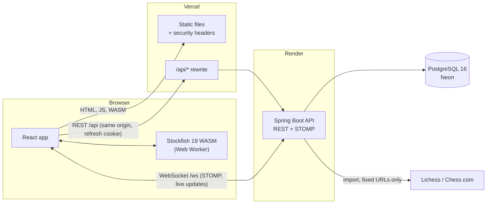

# Sjakkportal

[](https://github.com/OWNER/REPO/actions/workflows/ci.yml)


A chess portal for one family. Games are mostly played over the board and registered on a phone
during or after play. The opponent confirms the result, and only then does it count for the Elo ratings
(kept separately for blitz, rapid and classical). Stockfish runs in the browser to analyse finished games.
A living-room TV shows the game in progress, and tournaments pair themselves.

The interface is in Norwegian (bokmål); code and documentation are in English.

> Replace `OWNER/REPO` in the badge above with the GitHub path once the repository is pushed.

## Features

- **Games**:
  - Register a result, with or without the moves (PGN), or enter moves live, one by one, while the game is played.
  - A result registered by a player stays *pending* until the opponent confirms it; an admin can register or confirm any game.
  - Separate Elo ratings for blitz, rapid and classical.
  - Each player sees what they stand to win, draw or lose before a game.
- **Analysis**:
  - Stockfish 19 (WebAssembly) runs in a Web Worker on the viewer's device.
  - The analysis gives accuracy per player, move grades (brilliant → blunder), the turning points and an evaluation graph.
  - It is saved, so each game only needs analysing once.
- **TV mode** (`/tv`): a full-screen board for the living room that follows the live game over WebSocket.
  Press F for full screen and E for the evaluation bar.
- **Tournaments**:
  - Formats: round-robin (single or double), Swiss, single and double elimination, and arena.
  - Draws in knockout games are settled by a per-tournament rule: replay, a blitz playoff with armageddon, or straight armageddon.
- **Statistics**:
  - Leaderboards per time category, rating history and head-to-head records.
  - A matchup forecast from the Elo model, current streaks, and badges.
- **Import**: games between family members from Lichess or Chess.com links, for analysis (unrated).
- **Accounts**:
  - Invite codes (no open sign-up) and short-lived refresh-token sessions with reuse detection.
  - Admin password resets, and "managed" players without a login (for the youngest).

## Architecture



The browser reaches the API through the frontend's own domain, so the refresh cookie is first-party,
including in Safari. WebSockets cannot pass through a Vercel rewrite, so the live connection goes
straight to Render; it authenticates with the access token, not the cookie.
[docs/ARCHITECTURE.md](docs/ARCHITECTURE.md) has the details.

| Part | Technology |
|------|------------|
| Backend | Java 21, Spring Boot 3.5 (Web, Security, Data JPA, WebSocket), Flyway, Bucket4j, jjwt, `io.github.wolfraam:chessgame` |
| Database | PostgreSQL 16 |
| Frontend | React 19, TypeScript, Vite, Tailwind CSS 4, React Router 7, react-chessboard, chess.js, Recharts, STOMP.js |
| Engine | Stockfish 19 "lite" WebAssembly build, single-threaded (no special headers needed) |
| Tests | JUnit 5 + Spring MockMvc against a real PostgreSQL (backend); Vitest + Testing Library (frontend) |

## Documentation

| Document | Contents |
|----------|----------|
| [docs/ARCHITECTURE.md](docs/ARCHITECTURE.md) | System design, game lifecycle, live updates, the Stockfish worker, Elo maths, tournament engine, concurrency |
| [docs/API_AND_ERRORS.md](docs/API_AND_ERRORS.md) | Every endpoint, the error format, the complete error-code catalog, troubleshooting |
| [docs/SECURITY.md](docs/SECURITY.md) | Threat model, sessions, invites, rate limits, headers, known limitations |
| [docs/DEPLOYMENT.md](docs/DEPLOYMENT.md) | Step by step: Neon, Render, Vercel, first admin, checks, backups, costs |

## Quick start (local)

Requires Java 21, Node 22 and Docker.

```bash
docker compose up -d                     # PostgreSQL 16 on localhost:5432 (also creates the test database)

cd backend
SJAKKPORTAL_ADMIN_USERNAME=admin SJAKKPORTAL_ADMIN_PASSWORD='choose-a-password' ./gradlew bootRun
# API on http://localhost:8080

cd ../frontend                           # in a second terminal
npm install                              # also copies the Stockfish engine into public/stockfish
npm run dev                              # http://localhost:5173 (proxies /api and /ws to :8080)
```

Log in as `admin`. You will be asked to choose a new password first. Then go to **Admin → Invitasjoner**
to create an invite code for the family.

### Tests

```bash
cd backend && ./gradlew test             # 774 tests against the PostgreSQL from docker compose
cd frontend && npm test                  # 68 tests, including the engine driver against real Stockfish
cd frontend && npm run build             # type-check and production build
```

`./gradlew test -PreportOnly` runs every test without stopping the build on failures; the report is
written to `backend/build/reports/tests/test/index.html`. CI runs both suites on every push
([.github/workflows/ci.yml](.github/workflows/ci.yml)).

## Configuration

Backend settings are environment variables; the defaults suit local development with
`docker-compose.yml`. Examples: [backend/.env.example](backend/.env.example), [frontend/.env.example](frontend/.env.example).

| Variable | Default | Purpose |
|----------|---------|---------|
| `DATABASE_URL` | `jdbc:postgresql://localhost:5432/sjakkportal` | JDBC URL. For Neon: `jdbc:postgresql://<host>/<db>?sslmode=require` |
| `DATABASE_USERNAME` | `sjakkportal` | Database user |
| `DATABASE_PASSWORD` | `sjakkportal` | Database password |
| `DATABASE_POOL_SIZE` | `5` | Maximum database connections |
| `PORT` | `8080` | HTTP port (Render sets this to 10000) |
| `SJAKKPORTAL_JWT_SECRET` | random per start | Base64 key (≥ 256 bits) that signs access tokens. **Set it in production**: `openssl rand -base64 48` |
| `SJAKKPORTAL_ALLOWED_ORIGINS` | `http://localhost:5173` | Exact frontend origins, comma-separated. Requests and WebSocket handshakes from other origins are refused |
| `SJAKKPORTAL_COOKIE_SAME_SITE` | `Lax` | SameSite attribute of the refresh cookie. `Lax` when `/api` is proxied through the frontend's domain |
| `SJAKKPORTAL_ADMIN_USERNAME` | empty | First admin, created at startup only while no admin exists |
| `SJAKKPORTAL_ADMIN_PASSWORD` | empty | Its temporary password; it must be changed at first login |
| `SJAKKPORTAL_CLIENT_IP_HEADER` | empty | Header to take the client address from, for per-address rate limits. Empty: the connection address. See [docs/SECURITY.md](docs/SECURITY.md#client-address-behind-proxies) |
| `SJAKKPORTAL_CLIENT_IP_TRUSTED_HOPS` | `1` | Which entry of that header to use, counted from the right |
| `VITE_API_URL` | empty | Frontend build: API base URL. Empty when `/api` is on the same origin (the dev proxy, the Vercel rewrite) |
| `VITE_WS_URL` | empty | Frontend build: WebSocket URL. In production `wss://<render-service>.onrender.com/ws` |

Rate limits and token lifetimes are in [application.yml](backend/src/main/resources/application.yml)
(`sjakkportal.rate-limit.*`, `sjakkportal.jwt.*`).

## Deployment

Recommended: Vercel (frontend) + Render (backend, Docker) + Neon (PostgreSQL). All three have free
tiers that fit a family. The step-by-step guide is in [docs/DEPLOYMENT.md](docs/DEPLOYMENT.md). It
also covers what the free tiers cost you: the backend sleeps after 15 quiet minutes and takes about
a minute to wake.

## Repository layout

```
backend/            Spring Boot API (Dockerfile, Gradle build, Flyway migrations in src/main/resources/db/migration)
frontend/           React app (vercel.json, Stockfish copied to public/stockfish on install)
docs/               Architecture, API and error catalog, security, deployment
docker-compose.yml  Local PostgreSQL
render.yaml         Render Blueprint for the backend
.github/workflows/  CI
```
