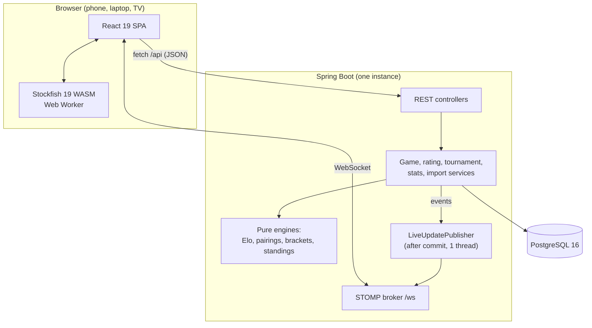
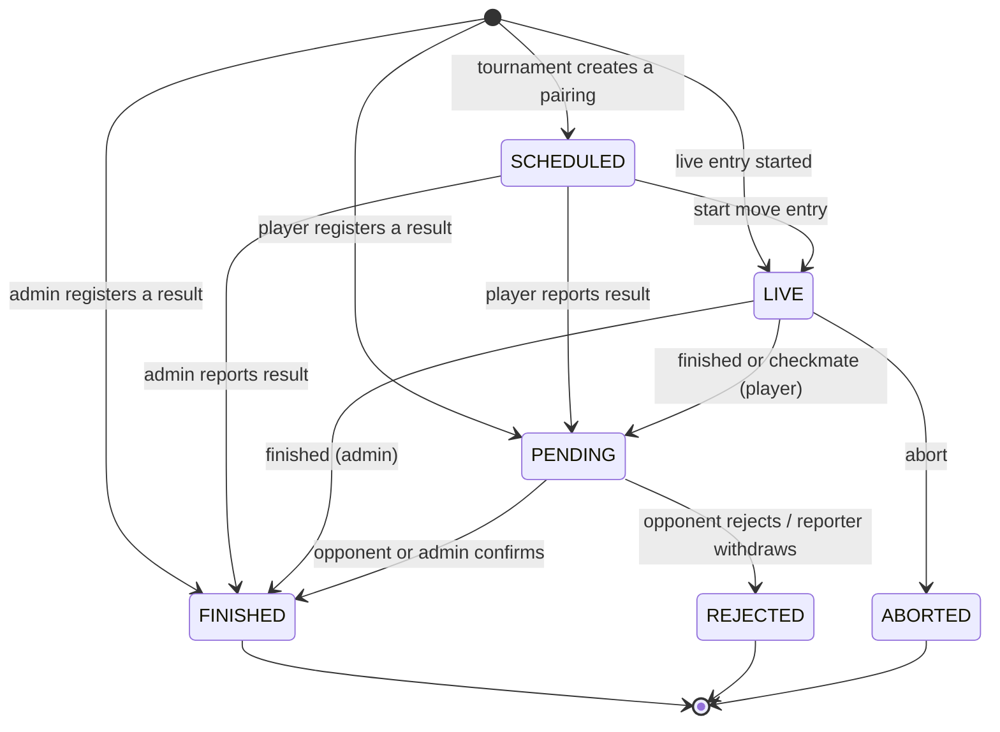
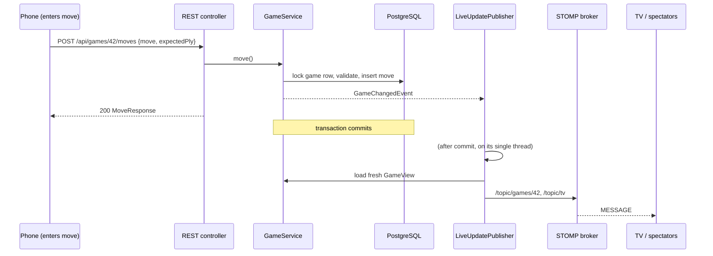
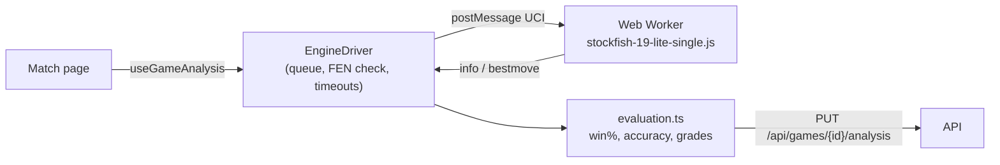

# Architecture

This document explains how Sjakkportal is put together and why. For endpoints and error codes see
[API_AND_ERRORS.md](API_AND_ERRORS.md); for the security design see [SECURITY.md](SECURITY.md).

## Overview



The design follows three rules.

1. **The server holds the truth; the browser does the expensive work.** All rules that affect other people are enforced on the server:
   - move legality;
   - who may confirm a result;
   - ratings;
   - tournament progression.

   Engine analysis is the exception. It costs CPU and changes nothing for anyone else, so it runs on
   the viewer's device and only the summary is stored. The server validates its shape.
2. **Pure logic is separate from persistence.** Elo, Swiss pairing, Berger tables, brackets, arena
   scoring and standings are plain Java classes with no Spring or database dependencies, under
   `rating/` and `tournament/engine/`. They are tested exhaustively on their own. The services load
   state, call them and store the result.
3. **One instance is enough, and the code may assume it.** A family generates a handful of requests a
   minute. The STOMP broker and the rate-limit buckets are in memory. Scaling out would need a
   shared broker and a shared rate-limit store, and this document notes each such place.

### Backend packages

| Package | Responsibility |
|---------|----------------|
| `auth`, `security` | Login, registration, refresh-token rotation, password policy, JWT, request guards, security headers |
| `invite`, `admin` | Invite codes, admin operations, bootstrap admin, request diagnostics |
| `user` | Profiles, linked Lichess/Chess.com usernames |
| `game` | Game lifecycle, live move entry, confirmations, analysis storage |
| `chess` | Wrapper around the chess library: PGN/FEN parsing, legality, SAN/UCI |
| `rating` | Elo maths and per-category ratings |
| `tournament` (+ `engine`) | Tournament lifecycle and the pure pairing/bracket/standings engines |
| `live` | WebSocket config, TV selection, broadcasting |
| `importer` | Lichess/Chess.com link parsing and fetching |
| `stats` | Leaderboards, player statistics, badges, matchup forecasts |
| `common` | Error catalog, problem responses, trace ids, sanitising, audit log |

### Frontend structure

| Folder | Contents |
|--------|----------|
| `src/lib` | API client (token refresh, error mapping, cold-start waiting), auth context, STOMP client, formatting |
| `src/analysis` | UCI protocol, engine driver, evaluation maths, analysis hooks |
| `src/components` | Board, evaluation bar, game lists, layout, error screens, wake banner |
| `src/pages` | One file per route; heavier pages are loaded on demand |

## Data model

Flyway owns the schema (`backend/src/main/resources/db/migration`); Hibernate only validates it
(`ddl-auto: validate`). The main tables:

| Table | Notes |
|-------|-------|
| `app_user` | Role, `managed` flag (no login), BCrypt hash, `token_version` (bumped to revoke all access tokens), linked online usernames (unique, case-insensitive) |
| `player_rating` | One row per user and category (BLITZ, RAPID, CLASSICAL): rating, rated-game count |
| `rating_history` | Every rating change, with game and category |
| `game` | Players, status, result, category, time control, PGN, `registered_by`, `confirmed_by`, `client_request_id` (idempotency), `external_id` (imports), tournament pairing and stage |
| `game_move` | Moves of live-entered games, one row per ply |
| `game_analysis` | Saved Stockfish summary (accuracies, per-move grades as JSONB) |
| `tournament`, `tournament_participant`, `tournament_round`, `tournament_pairing` | Tournament state; pairings record who advanced and when |
| `invite_code`, `invite_redemption` | Codes, limits and who used them |
| `refresh_token`, `password_reset_token` | SHA-256 hashes only, with family ids for reuse detection |
| `audit_log` | Security-relevant actions (logins, resets, admin changes, confirmations) |

Badges are computed from games when a profile is read rather than stored, so they can never disagree with the history.

## Game lifecycle



- **Ratings move exactly once**, when a game becomes FINISHED. The same transaction then hands the
  game to the tournament service (`GameFinishedEvent`, handled synchronously), so a confirmed
  tournament game and its effect on the tournament commit together or not at all.
- **The reporter cannot confirm their own result** (`CHESS-GAME-008`). An admin's registration is
  final at once.
- **Imported games** go straight to FINISHED and are never rated.
- **Idempotency.** `POST /api/games` accepts an `Idempotency-Key` header. A repeated submission with the same key
  returns the original game instead of creating a second one, so a double tap or a retry on a bad
  connection is harmless.
- **Live move entry** uses optimistic concurrency at the level of the position. Each move carries `expectedPly`.
  If two phones enter a move for the same position, the second gets `CHESS-GAME-005` and reloads.

## Live updates



- **Topics:**
  - `/topic/games/{id}`: a game page;
  - `/topic/tv`: what TV mode should show;
  - `/topic/tournaments/{id}`: standings and pairings.
- **After commit only.** A change that rolls back is never broadcast.
- **One background thread.** The request does not wait for broadcasting, and updates for a game
  arrive in the order they happened.
- **Messages are complete views, not diffs.** A client that missed one message is still correct after the next.
- **Authentication.** The browser's STOMP CONNECT frame carries `Authorization: Bearer <access token>`.
  The handshake itself is allowed only from configured origins.
- **Reconnects.** The client reconnects every 3 seconds after a drop and subscribes again. Heartbeats
  every 10 seconds detect dead connections, and also count as traffic, which keeps a free Render
  instance awake while a TV is showing a game.
- **TV selection**, in priority order:
  1. the featured game while it is live;
  2. the most recently active live game;
  3. the featured game after it ends;
  4. the latest finished game.

*Scaling note:* the simple in-memory broker means all WebSocket clients must reach the same
instance. Several instances would need a STOMP relay (RabbitMQ, ActiveMQ).

## Stockfish in the browser



- **The build.**
  - The single-threaded "lite" build (about 1.8 MB of WASM) is copied from the `stockfish` npm package into
    `public/stockfish/` by `scripts/copy-engine.mjs` on `npm install`.
  - It needs no `SharedArrayBuffer`, so no COOP/COEP headers. If the page *is* cross-origin isolated,
    the multi-threaded build is used instead.
- **The driver.**
  - `EngineDriver` speaks UCI: `uci` → `isready` → `position fen …` → `go depth 14`.
  - It serialises requests through a queue, so one worker serves the whole page.
  - It rejects malformed FEN before it reaches the engine.
  - Its tests run against the real Node build of the same engine.
- **The maths** follows Lichess's published formulas, so the numbers feel familiar:
  - win% = `50 + 50·(2/(1+e^(−0.00368208·cp)) − 1)`; a forced mate counts as 100 or 0;
  - move accuracy = `103.1668·e^(−0.04354·Δwin%) − 3.1669`, capped to 0–100, and 100 when nothing was lost;
  - game accuracy is the mean of move accuracies;
  - ACPL is centipawns lost per move, capped at 1000.
- **Grades**, by win% given away:

  | Win% lost | Grade |
  |-----------|-------|
  | ≥ 20 | blunder |
  | ≥ 10 | mistake |
  | ≥ 5 | inaccuracy |
  | ≥ 2 | good |
  | < 2 | excellent |

  The engine's own move is *best*. It is *brilliant* when it is also a sacrifice (a non-pawn piece
  left where it can be taken for less) that keeps the mover at ≥ 50 %.
- **Turning points** are moves that swing the win chance by at least 8 percentage points.
- **Live evaluation** in TV mode and on live games runs the same engine at a lower depth, on the viewer's device.

## Elo ratings

Every player has three independent ratings: blitz, rapid and classical. A game's category comes from
its time control `minutes+increment`, using the estimated length `minutes + increment` (60 moves per
player):

| Estimated minutes | Category |
|-------------------|----------|
| < 10 | blitz |
| 10–59 | rapid |
| ≥ 60, or no clock | classical |

If the client sends both a category and a time control and they disagree, the game is refused (`CHESS-GAME-009`).

**Expected score** of A against B:

```
E_A = 1 / (1 + 10^((R_B − R_A) / 400))
```

**K-factor**: 40 for a player's first 20 rated games in that category, then 20, and 10 at 2400+.

**Change**: `ΔR = K · (S − E)`, where S is 1, ½ or 0.

- **Rounding.** Changes are rounded half away from zero (Java's `Math.round` would round −2.5 to −2,
  making losses slightly smaller than gains).
- **Zero sum.** With equal K the exchange is exactly zero-sum: Black's change is the negation of
  White's, avoiding floating-point drift.
- **Floor.** Ratings never drop below 100.
- **Starting rating.** Every rating starts at 1200.
- **Stakes** shown before a game are the same formula evaluated for S = 1, ½ and 0.

**Win/draw/loss forecast** (matchups, stakes). Elo predicts only an expected score, so the draw
probability is modelled as a fixed share of the contested mass:

```
P(draw)  = 2 · 0.2 · min(E, 1 − E)
P(win)   = E − P(draw) / 2
P(loss)  = 1 − P(win) − P(draw)
```

This keeps `P(win) + ½·P(draw) = E` exactly, gives equal players a 20 % draw chance, and can never
produce a negative probability.

**Concurrency.** Rating rows for both players are locked in user-id order before reading, so two
confirmations involving the same player never interleave and never deadlock.

## Tournaments

Lifecycle: **DRAFT** (sign-up) → **ACTIVE** → **FINISHED**, or **CANCELLED**.

- **Rounds and games.** Every pairing creates a SCHEDULED game. Its result goes through the same
  report/confirm rules as any other game. When the game becomes FINISHED, the tournament service
  records the pairing result in the same transaction. Once the round is complete, it creates the next round.
- **The tournament lock.** Every state change locks the tournament row (`SELECT … FOR UPDATE`)
  first. When the last two games of a round are confirmed at the same moment, the next round is
  created exactly once.

| Format | Engine | Notes |
|--------|--------|-------|
| Round-robin, double round-robin | `RoundRobinScheduler` | Berger tables (circle method). With an odd field a ghost seat gives one bye per round; the double variant repeats with colours swapped |
| Swiss | `SwissPairer` | Depth-first backtracking over the ranking. Hard rules: no rematches, at most one bye each, never the same colour three times in a row. Preferences: equal scores, top half v bottom half, colour balance. Up to 30 rounds |
| Single / double elimination | `EliminationBracket` | Standard seeding (top two seeds can only meet in the final), byes for top seeds. Double elimination has a losers bracket and a grand-final reset |
| Arena | `ArenaScoring` | Players register games freely during the arena window. Win 2, draw 1, loss 0; from the third consecutive win each game scores double until a non-win (which still scores double) |

**Standings** (all formats except arena): score, then head-to-head among the tied players, then
Buchholz, then Sonneborn-Berger. Players still level share a rank. Points are counted in half-points
internally, so ten draws equal five wins exactly.

**Draws in knockout games.** A bracket match needs a winner, so each knockout tournament chooses a rule:

| Rule | What happens after a drawn game |
|------|---------------------------------|
| `REPLAY` | Play again with colours reversed, until someone wins |
| `BLITZ_PLAYOFF` | Two 5+3 blitz games (colours alternate). If still level, one armageddon game |
| `ARMAGEDDON` | One armageddon game: a draw sends Black through |

The bracket is deterministic: replaying the stored results on the same seeds rebuilds the same state.
That is how it is restored from the database. It is never stored as a graph.

## Concurrency, consistency and failure handling

| Situation | Mechanism |
|-----------|-----------|
| Two people confirm or edit the same game | Game row locked with `PESSIMISTIC_WRITE`; JPA `@Version` as a backstop → `CHESS-GAME-005` / `CHESS-GEN-005` |
| Two moves for the same position | `expectedPly` check under the game lock |
| Concurrent rating updates | Rating rows locked in user-id order |
| Last games of a round confirmed together | Tournament row lock; the next round is created once |
| Invite code used by many at once | A single `UPDATE … SET uses = uses + 1 WHERE uses < max_uses RETURNING` claims a use atomically |
| Same refresh token presented twice | Rotation with reuse detection: the whole token family is revoked |
| Broadcast fails | Logged; the next change sends a full view again |
| Server asleep (free hosting) | The browser waits for `/api/ping`, repeats reads, and asks the user to press write buttons again (`CHESS-CLIENT-004`) |

## Error handling and tracing

Every error is an RFC 9457 problem document with a stable code from the catalog in
`common/error/ErrorCode.java`, documented in [API_AND_ERRORS.md](API_AND_ERRORS.md).

- **Trace ids.** Every request carries an `X-Trace-Id`. The browser generates one (prefix `web-`); otherwise
  the server does. It is returned in the response header, included in every problem body, and
  present in every log line for that request (MDC), so a user's screenshot of an error leads straight to the log entry.
- **Stack traces** never reach the client.

## Testing strategy

The code was written test-first.

**Backend** (JUnit 5, PostgreSQL):
- Integration tests drive the real HTTP layer (MockMvc, and a real port for WebSocket tests) against
  a real PostgreSQL. Tables are truncated between tests.
- The pure engines have exhaustive unit tests: Elo tables, Swiss pairing invariants over many random
  tournaments, bracket progression for every field size, and standings tie-breaks.
- Guard tests check that:
  - every error code is unique and documented;
  - every foreign key is indexed;
  - the documentation lists every environment variable.

**Frontend** (Vitest):
- The API client: token refresh, error mapping, cold-start waiting.
- The UCI parser, the evaluation maths, and the engine driver against the real Stockfish build.
- Auth pages and error screens.
