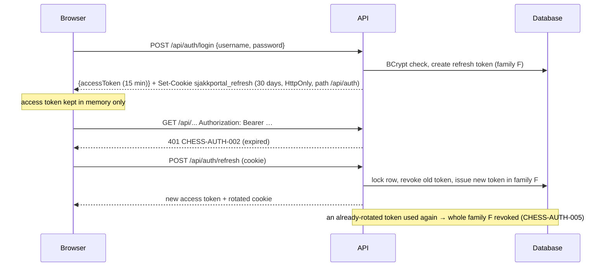

# Security

Sjakkportal holds little that is sensitive: names, chess games and password hashes for a family. The
security goals are proportionate to that, but done properly:

1. Nobody outside the family can sign up, read games or change results.
2. Family members cannot change ratings by themselves: results need the opponent's confirmation.
3. A stolen session expires quickly and can be detected; a leaked database does not reveal passwords.
4. The service cannot be turned against others: no open redirects, no fetching arbitrary URLs, no XSS.

## Threat model

| Threat | Mitigation |
|--------|------------|
| Strangers registering | No open sign-up; registration needs an invite code (limited uses, expiry, revocable) |
| Guessing passwords | BCrypt (cost 12); per-username and per-address login limits; identical timing for unknown users |
| Guessing invite codes | Generated codes carry 80 bits of randomness; 10 attempts a minute per address |
| Stolen access token | 15-minute lifetime, memory only (never in `localStorage`); revoked by password change or reset (`token_version`) |
| Stolen refresh token | HttpOnly, Secure, SameSite cookie scoped to `/api/auth`; rotated on every use; reuse revokes the whole family; hashed at rest |
| A player inflating their rating | Results registered by a player stay PENDING until the opponent or an admin confirms; the reporter cannot confirm (`CHESS-GAME-008`) |
| Editing someone else's game | Only the two players or an admin may change a game (`CHESS-GAME-007`) |
| Cross-site request forgery | No cookie authenticates API calls (bearer tokens only); the refresh cookie is SameSite and path-scoped; foreign `Origin` headers are refused |
| Cross-site scripting | React escapes all output; free text is stripped of markup on input; strict CSP with no inline scripts |
| Clickjacking | `frame-ancestors 'none'` and `X-Frame-Options: DENY` |
| Server-side request forgery via import | The importer never requests a user-supplied URL. It parses a game id from Lichess/Chess.com links and builds the request URL itself; 5 s connect / 10 s read timeouts; 5 MB response cap |
| Resource exhaustion | Request size limits on every text field; PGN ≤ 200 000 characters; paging ≤ 100; rate limits on game submission |
| Leaked errors | Problem responses carry a code and a Norwegian message only. Stack traces stay in the server log, linked by trace id |
| Leaked database | Passwords are BCrypt hashes; refresh and reset tokens are stored as SHA-256 hashes |
| An admin abusing their power | Out of scope to prevent, but admin actions are audited (see below) |

Out of scope: a compromised hosting account, and someone with physical access to
an unlocked family phone.

## Authentication lifecycle



**Access tokens** are HS256 JWTs signed with `SJAKKPORTAL_JWT_SECRET`. A token contains the user id
and the user's `token_version`. Changing or resetting a password increments the version, which
invalidates every outstanding access token at once. Tokens are kept in JavaScript memory, never in
`localStorage` or `sessionStorage`, so an XSS bug could not read a stored token. On a page load
the session is restored through the refresh cookie.

**Refresh tokens** are 256-bit random strings. Only their SHA-256 hash is stored. Each one belongs to a
*family* that starts at login.
- **Rotation.** Every refresh revokes the presented token and issues a successor in the same family;
  the row lock makes concurrent refreshes safe.
- **Reuse detection.** If a revoked token is presented again, someone holds a copy, so every
  token in the family is revoked and that login ends.
- **Logout** revokes the current token. A password change, or a reset by an admin, revokes all of the
  user's tokens.

**The cookie**:
- `sjakkportal_refresh` is `HttpOnly; Secure; SameSite=Lax; Path=/api/auth` and lasts 30 days.
- The path means it is sent to the auth endpoints and nowhere else.
- In production the browser reaches `/api` through the frontend's own domain (the Vercel rewrite), so
  the cookie is first-party and SameSite=Lax is enough. That also avoids Safari's blocking of
  third-party cookies, which no SameSite value works around.

**Passwords**:
- BCrypt with cost 12.
- At least 8 characters, at most 72 bytes (BCrypt ignores anything longer, so longer passwords are refused rather than silently truncated), and not equal to the username.
- A login for an unknown username still runs one BCrypt comparison against a dummy hash, so response
  time does not reveal which usernames exist.

**First admin.**
- Created at startup from `SJAKKPORTAL_ADMIN_USERNAME` / `SJAKKPORTAL_ADMIN_PASSWORD`, only while the database has no admin.
- The account is flagged *must change password*. Until it is changed, only
  `change-password`, `logout` and `users/me` respond (`CHESS-AUTH-004`).
- Remove the two variables after the first login.

**Password resets** (there is no email): an admin chooses either
- a temporary password, shown once, which must be changed at next login; or
- a reset link valid for 24 hours and usable once.

Issuing a new reset invalidates any earlier unused link for that user.

**Disabling an account** (a lost phone, someone who should no longer have access): an admin presses
**Deaktiver**. Login is refused from then on, every access token stops working at once (`token_version`),
and every refresh token is revoked. The account's games and ratings stay. Only someone who types the
correct password is told the account is disabled; anyone else sees an ordinary wrong-password error.
Admins cannot disable themselves. **Aktiver** lets the account back in.

**Managed players** (young children) have no password and cannot log in. Admins register their games.

## Invite codes

- Generated codes look like `K7QM-2RXD-9HFA-T3NP`: 16 characters from a 32-character alphabet without look-alikes (no 0/O, 1/I/L), so 80 bits.
- Admins may instead choose a memorable code such as `JUL-2026`. Give such a code few uses and a short expiry: it is far easier to guess.
- **Atomic redemption.** A code is redeemed with one atomic `UPDATE … WHERE uses < max_uses`, so a code with one use left cannot be used twice by simultaneous registrations.
- **Records.** Every redemption is recorded with the new user. Codes can be revoked at any time.

## Rate limits

Token buckets (Bucket4j) in memory. Limits are configured in `application.yml` under `sjakkportal.rate-limit`.

| Limit | Key | Capacity |
|-------|-----|----------|
| Login | username + client address | 5 per minute |
| Login | client address | 20 per minute |
| Registration (invite attempts) | client address | 10 per minute |
| Password reset with a link | client address | 5 per minute |
| Game submission | user | 30 per minute |

Chess clock presses (`PUT /api/games/{id}/clock`) are deliberately not limited: a fast game can
need several presses per second. Only the two players and admins can press, only while the game is
live, and each press replaces a single row.

Exceeding a limit returns 429 `CHESS-RATE-001` with `Retry-After`. The store holds at most 10 000
buckets (least recently used are dropped) so it cannot grow without bound. A restart resets the
limits; with several instances each would count separately.

### Client address behind proxies

In production every request arrives through proxies (Vercel's edge, then Render's). By default
(`SJAKKPORTAL_CLIENT_IP_HEADER` empty) the server uses the **connection address**, which is Render's
proxy. Then everyone shares one per-address bucket.

| | Default: shared bucket | With the header set |
|---|---|---|
| **Effect** | The whole internet gets 20 login attempts a minute in total, on top of the per-username limit | Each visitor counts separately |
| **Trade-off** | An attacker hammering the login page can make the family wait a minute before logging in | Someone who calls the Render address directly, bypassing Vercel, can write arbitrary addresses into the header and so escape the per-address limits |
| **When to use** | Recommended for a family | Only if the shared bucket causes problems |

A spoofed address does not escape the per-username limit or BCrypt's cost.

The resolver only ever uses entries appended by proxies you trust. It takes the entry
`SJAKKPORTAL_CLIENT_IP_TRUSTED_HOPS` positions from the right, never the left-most one, which the
client controls. It falls back to the connection address when the header is missing or malformed. To choose the
values, deploy, log in as admin, and open **Admin → Tilkobling**. That page shows the headers as they
arrive and which address the rate limiter uses. [DEPLOYMENT.md](DEPLOYMENT.md#client-address-optional) walks through it.

## HTTP security headers

**API responses (Spring Security):**
- `Content-Security-Policy: default-src 'none'; frame-ancestors 'none'`: the API never serves pages;
- `Strict-Transport-Security: max-age=31536000; includeSubDomains`, only when the app itself sees HTTPS (behind Render's proxy it sees HTTP, so in production HSTS comes from Vercel's headers for the site the browser actually visits);
- `X-Content-Type-Options: nosniff`;
- `X-Frame-Options: DENY`;
- `Referrer-Policy: no-referrer`;
- `Cache-Control: no-cache, no-store, max-age=0, must-revalidate`. Vercel also gets
  `x-vercel-enable-rewrite-caching: 0`, so its CDN never caches API responses.

**The web app (`frontend/vercel.json`):**

```
default-src 'self';
script-src 'self' 'wasm-unsafe-eval';    # Stockfish's WebAssembly; no inline or eval'd JavaScript
worker-src 'self';                        # the engine worker
style-src 'self' 'unsafe-inline';         # the board library positions pieces with inline styles
img-src 'self' data:;
font-src 'self';                          # fonts are bundled, no third-party font CDN
connect-src 'self' wss://*.onrender.com;  # API via the same origin, WebSocket to Render
object-src 'none'; base-uri 'self'; form-action 'self'; frame-ancestors 'none'
```

It also sets the following headers:
- `Strict-Transport-Security` (two years);
- `X-Content-Type-Options: nosniff`;
- `Referrer-Policy: strict-origin-when-cross-origin`;
- `Cross-Origin-Opener-Policy: same-origin`;
- a `Permissions-Policy` that disables camera, microphone, geolocation and payment.

The app loads nothing from third parties: no analytics, fonts, CDNs or trackers.

## CORS and origins

`SJAKKPORTAL_ALLOWED_ORIGINS` lists the exact frontend origins. The setting is enforced in three places:
- the CORS configuration;
- a filter that refuses any browser request whose `Origin` is not on the list (`CHESS-AUTH-003`), even for endpoints where CORS alone would let a "simple" request through;
- the WebSocket handshake.

A malformed `Origin` is refused, not parsed loosely.

## Input handling

- **Validation.** Bean Validation on every request body, with length caps on every string.
- **Free text** (names, comments, rejection reasons, invite notes) is stripped of tags, angle brackets and control characters on the way in. React escapes on the way out as well.
- **Chess input.** Moves, PGN and FEN are parsed by the chess library and re-validated. Moves are
  replayed from the start position on the server; the browser's opinion of legality is never trusted.
- **Analyses** sent by the browser are checked against the game: move count, value ranges, classification names. A tampered analysis cannot affect ratings anyway.
- **SQL** is always parameterised (JPA or `JdbcClient` with bound parameters).

## Audit log

Admin actions are written to `audit_log` with the actor, target and request trace id:
- invites created and revoked;
- password resets issued;
- accounts disabled and enabled;
- managed players created;
- games registered, reported, finished or confirmed by an admin;
- results corrected (`GAME_CORRECTED`) and games annulled (`GAME_ANNULLED`), with the old and new
  result and the admin's reason;
- tournaments created, started, finished and cancelled.

Logins and players' own actions are not audited; the games, ratings and tokens tables already record who did what.

Query it with SQL (Neon's SQL editor) when something needs explaining.

## Secrets

| Secret | Where | Rotation |
|--------|-------|----------|
| `SJAKKPORTAL_JWT_SECRET` | Render (generated by the Blueprint) | Change it and redeploy: everyone's access token stops working, and the next refresh issues a new one transparently |
| Database password | Render env vars, from Neon | Reset in Neon, update in Render |
| Bootstrap admin password | Render, first deploy only | Delete both variables after the first login |

No secrets are in the repository or in the frontend bundle. `VITE_*` values are public by design.

## Known limitations

- **No email.** Password recovery goes through an admin.
- **No two-factor authentication.**
- **Rate limits** are per instance and reset on restart; see also the proxy trade-off above.
- **The Chess.com import** depends on an unofficial endpoint; if it changes, imports fail cleanly with `CHESS-IMPORT-002`.
- **Admin trust.** An admin can register and confirm any result. Admin actions are audited, not prevented.
- **Analysis trust.** The browser computes engine analysis. A determined user could submit a fabricated
  analysis of their own game. Analyses never affect ratings, and they are validated for shape and range.

## How this is tested

The promises in this document are tested from outside, the way an attacker would probe them. The
tests live in `backend/src/test/java/no/sjakkportal/audit/`; they were written from this document and
[API_AND_ERRORS.md](API_AND_ERRORS.md) before the code was re-read.

| Test | What it attacks |
|------|-----------------|
| `AccessControlMatrixTest` | Every endpoint with no token, a forged or malformed token, and a player's token on admin endpoints. Also fails if an endpoint exists that is not documented, or is documented but missing |
| `SecurityAuditTest` | Token tampering (`alg: none`, edited payload, wrong key, expiry), session revocation, refresh-token reuse, cookie flags, CSRF via foreign origins, mass assignment, enumeration, password policy, reset links, invites, markup in free text, oversized and malformed input, data exposure, actuator, CORS, rate limits |
| `WebSocketSecurityAuditTest` | Connecting without or with a forged token, foreign-origin handshakes, and clients trying to publish fake updates to other viewers |
| `IntegrityAuditTest` | Who may register, confirm, reject and move; ratings applied exactly once (also under concurrency); unrated games; tournament and arena rules; analysis tampering |
| `ImportAndParameterAuditTest` | Import links crafted to reach other hosts (cloud metadata, look-alike domains, `file:`), non-JSON bodies, bad query parameters |
| `AccountDisablingTest` | Disabling and enabling accounts |

## Reporting a problem

This is a private family project. If you find a security issue, tell the admin directly rather than
opening a public issue.
